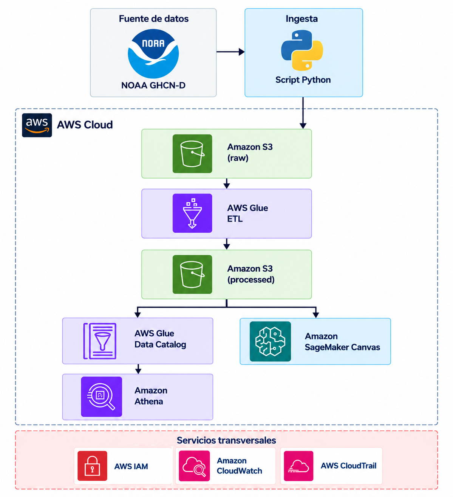

# Arquitectura de la solución

## Descripción

La solución implementa un pipeline batch de Ingeniería de Datos sobre AWS, diseñado para integrar, transformar, almacenar y analizar información meteorológica histórica.

La arquitectura permite incorporar nuevas fechas y regiones sin modificar su estructura general.

## Diagrama de arquitectura

## Componentes

| Etapa | Tecnología | Función |
|---|---|---|
| Fuente | NOAA GHCN-D | Datos meteorológicos históricos |
| Ingesta | Python | Extracción parametrizable |
| Almacenamiento raw | Amazon S3 | Conservación de datos originales |
| Procesamiento | AWS Glue ETL | Transformación y preparación de datos |
| Almacenamiento processed | Amazon S3 | Datos procesados en Parquet |
| Catalogación | AWS Glue Data Catalog | Administración de metadatos |
| Análisis | Amazon Athena | Consultas SQL |
| Machine Learning | Amazon SageMaker Canvas | Modelo predictivo de regresión |
| Seguridad | AWS IAM y Amazon S3 | Permisos, cifrado y versionado |
| Monitoreo y auditoría | CloudWatch y CloudTrail | Seguimiento y trazabilidad |

### Almacenamiento de datos — Amazon S3

Se implementaron tres buckets Amazon S3 en la región `us-east-1`, diferenciados según su función dentro del pipeline:

| Bucket | Propósito |
|---|---|
| `de-noaa-raw-dblanco16` | Almacenamiento de datos originales NOAA GHCN-D. |
| `de-noaa-processed-dblanco16` | Destino de los datos transformados mediante AWS Glue. |
| `de-noaa-athena-dblanco16` | Almacenamiento de resultados de consultas de Amazon Athena. |

**Configuración:**
- Acceso público bloqueado.
- Cifrado predeterminado SSE-S3.
- Versionado desactivado.
- Object Lock desactivado.

La separación en tres buckets permite administrar independientemente las zonas de datos originales, procesados y resultados de consultas.

## Flujo de procesamiento

1. Un script Python obtiene datos desde NOAA GHCN-D.
2. Los archivos seleccionados se almacenan en Amazon S3, zona `raw`.
3. AWS Glue transforma los datos y genera resultados en formato Parquet.
4. Los resultados se almacenan en S3, zona `processed`.
5. AWS Glue Data Catalog registra los metadatos utilizados por Athena.
6. Amazon Athena permite realizar análisis mediante SQL.
7. SageMaker Canvas utiliza datos procesados para el entrenamiento y evaluación de modelos predictivos.

## Caso de uso inicial

- **Región geográfica:** Argentina.
- **Datos históricos:** 2016–2025.
- **Evaluación predictiva:** observaciones disponibles de 2026.
- **Objetivo del modelo:** predecir la precipitación mensual acumulada por ubicación.

## Extensibilidad

La ingesta se diseñará mediante parámetros que permitan seleccionar regiones y períodos.

El pipeline podrá ejecutarse periódicamente para incorporar nuevas observaciones. La implementación inicial será académica, sin automatizar la planificación de ejecuciones.

## Decisiones de diseño

- Procesamiento batch.
- Servicios administrados para minimizar la administración de infraestructura.
- Amazon S3 como almacenamiento central.
- Parquet como formato de datos procesados.
- SageMaker Canvas para simplificar el desarrollo del modelo predictivo.